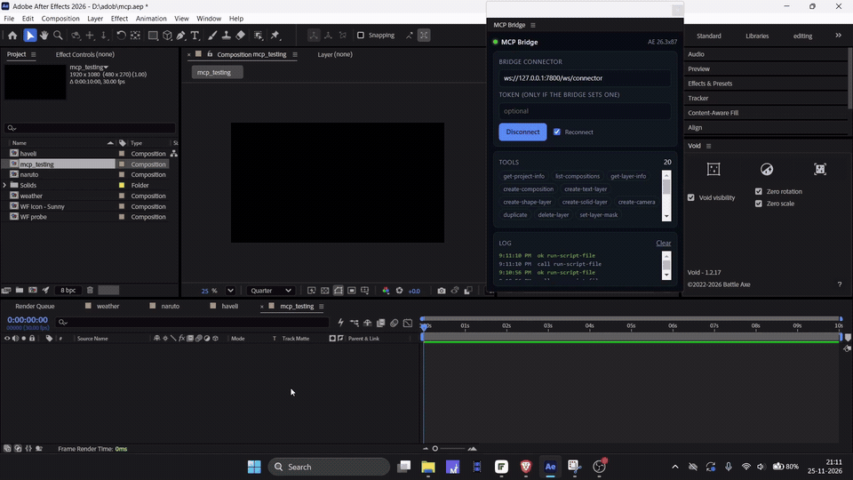

# 🎬 AFbridge MCP — After Effects MCP Server

An MCP server for Adobe After Effects: 27 tools that create compositions, add and animate layers,
apply effects, run ExtendScript and render frames, so an AI assistant can drive After Effects directly.
Everything is native AE content — shape layers, text, solids, keyframes, expressions, masks — with no
footage and no rendering tricks.



The same 27 tools ship two ways. Clone once, pick one path, and don't mix them.

```bash
git clone https://github.com/Rakeshcool/aftereffects_live_mcp.git
cd aftereffects_live_mcp
```

## 🔀 Pick a path

| | **Path A** — prebuilt binary | **Path B** — Node server |
| --- | --- | --- |
| MCP server | `afbridge-ae.exe` | `node build/index.js` |
| Needs `npm install` here | no | yes |
| Needs Node | for the bridge and a one-time panel install | 18+ for everything |
| Panel | CEP panel, talks to the bridge over WebSocket | ScriptUI panel, polls a command folder |
| Extra service | the [bridge](https://github.com/Rakeshcool/mcp-bridge) must be running | none |

Both paths need one After Effects setting first.

### ⚙️ Both paths: allow scripts in After Effects

**Preferences → Scripting & Expressions → Allow Scripts to Write Files and Access Network**
(Windows: *Edit → Preferences*; macOS: *After Effects → Settings*). Both panels run ExtendScript from
disk — the CEP panel loads its command library with `$.evalFile` — and every tool call fails while this
is off.

## ⚡ Path A — prebuilt binary

The binary is the same server as Path B: one 248 KB executable, no dependencies, starts instantly. It
replaces the Node MCP server, not the bridge — the bridge is a Node service, so Node 22.18+ is still
needed for it.

1. **Get the binary.** Download `afbridge-ae.exe` from the
   [latest release](https://github.com/Rakeshcool/aftereffects_live_mcp/releases/latest) and put it
   anywhere; `bin/` in this repo is gitignored.

2. **Install the CEP panel** (one time, uses Node but no `npm install`):

   ```bash
   npm run install-cep
   ```

3. **Start the bridge** next to this repo:

   ```bash
   git clone https://github.com/Rakeshcool/mcp-bridge.git ../mcp-bridge
   cd ../mcp-bridge
   bun install                # or npm install
   node scripts/mcp.mjs up    # http://127.0.0.1:7800
   ```

4. **Open the panel.** Restart After Effects, then *Window → Extensions → AFbridge MCP*.

5. **Approve it once, in the bridge.** Use the [AFbridge MCP bridge](https://github.com/Rakeshcool/mcp-bridge)
   panel it ships — open <http://127.0.0.1:7800/> → **Applications**, where this panel waits as
   *pending_approval*, and approve it. Its 27 tools are hidden until you do.

6. **Point your client at the binary:**

   ```json
   {
     "mcpServers": {
       "AFbridge MCP": { "command": "C:\\path\\to\\afbridge-ae.exe" }
     }
   }
   ```

The binary reads the tool catalogue built into it and forwards each call to the bridge, which relays it
to the panel. Useful flags: `--list-tools`, `--port 7800`, `--base http://127.0.0.1:7800`, `--version`,
or `AFBRIDGE_BASE` in the environment.

## 🟢 Path B — Node server

No bridge, no panel approval: the server writes command files to a folder that a ScriptUI panel polls.

1. **Install and build** (the build runs automatically):

   ```bash
   npm install
   ```

2. **Install the ScriptUI panel.** On Windows this raises a UAC prompt, because the panel goes into
   `Program Files`.

   ```bash
   npm run install-bridge
   ```

3. **Start the server:**

   ```bash
   npm start
   ```

4. **Register it with your MCP client.** The repo includes a `.mcp.json` that already points at
   `./build/index.js`; copy it into the folder your client runs from, or use an absolute path:

   ```json
   {
     "mcpServers": {
       "AFbridge MCP": { "command": "node", "args": ["C:\\path\\to\\aftereffects_live_mcp\\build\\index.js"] }
     }
   }
   ```

5. **Open the panel in After Effects:** *Window → mcp-bridge-auto.jsx*, and leave **Auto-run commands**
   ticked.

## 🛠 Tools

| Tool | Description |
| --- | --- |
| `get-project-info` | Project name, path, item counts, active composition, first 50 items |
| `list-compositions` | Index, name, size, duration, frame rate, layer count of every comp |
| `get-layer-info` | Layers of a comp, or one layer with timing, parent and effect count |
| `get-property-value` | Value, expression and keyframes; slash paths such as `Transform/Position` |
| `create-composition` | Create a composition |
| `set-composition-properties` | Change duration, frame rate or size |
| `create-text-layer` | Add a text layer |
| `create-shape-layer` | Add a shape layer: rectangle, ellipse, polygon or star |
| `create-solid-layer` | Add a solid or adjustment layer |
| `create-camera` | Add a camera layer |
| `duplicate-layer` | Duplicate a layer |
| `delete-layer` | Delete a layer |
| `set-layer-properties` | Transform, text, blending and timing |
| `batch-set-layer-properties` | The same, across several layers in one call |
| `set-layer-mask` | Create or restyle a mask from a path or a rectangle |
| `set-layer-keyframe` | Keyframe a Transform, Effects or Text property |
| `delete-keyframe` | Remove the keyframe nearest a time, or all of them |
| `set-layer-expression` | Set or remove an expression |
| `apply-effect` | Apply one effect by name, match name or preset |
| `apply-effect-template` | Apply a named effect template |
| `render-composition` | Render through the queue, or write one PNG frame |
| `set-property-value` | Write any property by slash path, constant or keyframed |
| `get-layer-property-tree` | Property tree with match names, so an exact path can be found |
| `purge-cache` | Drop AE caches |
| `save-project` | Save to the current file or to a path |
| `run-script` | Escape hatch: run ExtendScript from a string |
| `run-script-file` | Escape hatch: run a `.jsx` file |

## 🧩 The CEP panel (Path A)

A WebSocket client for the bridge: it dials `ws://127.0.0.1:7800/ws/connector`, registers as
**AFbridge MCP** with id `after-effects-panel`, and answers tool calls directly — no `get-results` step,
one tool call is one undo step. It must be open in AE; closing it makes the bridge report
`disconnected` and its tools leave the catalogue.

The panel's ExtendScript shares one implementation with Path B: `scripts/build-commands.mjs` extracts the
command functions from `mcp-bridge-auto.jsx` into the UI-free `src/scripts/ae-commands.jsx` (committed),
so both panels run the same code. Reinstall with `npm run install-cep` after changing either.

## 🧰 Development

```bash
npm run build        # typecheck, then esbuild -> build/index.js
npm run typecheck    # zod guard + tsc --noEmit
```

`npm run build` runs the typecheck first, and `postinstall`/`prepublishOnly` run the build, so a broken
dependency fails in milliseconds. That guard exists because zod must be **3.25 or newer and a single
copy**: against an older or duplicated zod, the SDK's `tool()` overloads never resolve, `tsc` reports
`TS2589` and eventually dies with `FATAL ERROR: Ineffective mark-compacts` — which looks like a broken
Node install but is purely the dependency. `scripts/check-zod.mjs` fails the build if a nested copy
returns; run `npm dedupe`.

**Native binary.** Its source is in [`native/`](native) — one crate, one dependency (`serde_json`):

```bash
cd native
cargo build --release          # -> native/target/release/afbridge-ae.exe
cargo run --release -- --list-tools
```

Rust 1.70+ is enough. `native/src/tools.json` is the catalogue baked in with `include_str!`; the tools
are defined by the panel, so regenerate it only when the tool set changes, with the bridge up and the
panel approved:

```bash
node native/scripts/gen-tools.mjs      # --port, --base, --out
```

It sorts by name and writes fixed formatting, so an unchanged panel produces a byte-identical file.

## 🩺 Troubleshooting

| Symptom | Fix |
| --- | --- |
| Panel shows nothing in `/api/tools` | approve it under *Applications* in the bridge panel |
| `MCP_APPROVAL_REQUIRED` | the same — a new application cannot connect until approved |
| Every tool call errors immediately | enable *Allow Scripts to Write Files and Access Network*, then restart AE |
| `bridge not reachable` | start it: `node scripts/mcp.mjs up` in `mcp-bridge` |
| `MCP_TOOL_NOT_FOUND` | the panel is closed or the server idle-stopped; reopen/connect it |
| Star or polygon looks wrong | update the panel: `npm run install-cep`, then restart AE |

## License

Apache License 2.0 — see [LICENSE](LICENSE).
